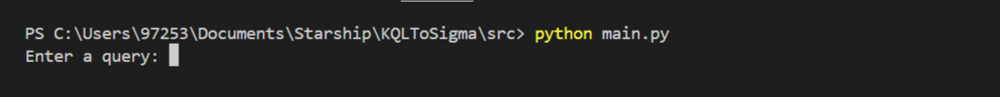
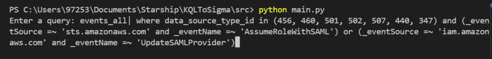

# KQLToSigma

This repository provides tools for converting KQL queries into Sigma rules. The project includes parsing KQL queries and generating equivalent Sigma rules.

## Installation

To install the required dependencies, run:

```bash
pip install -r requirements.txt
```

## Usage

Run the main script and provide a string of KQL query as input:

```bash
python main.py
```

You will be prompted to enter a KQL query, and the corresponding Sigma rule will be generated and displayed.





## Project Components

- `main.py`: The main entry point for the program, handling user input and conversion.
- `KQL.py`: Parses and extracts relevant information from KQL queries.
- `SigmaRuleGenerator.py`: Generates Sigma rules based on parsed KQL queries.
- `utils/`: Contains helper functions and configurations for processing queries.

## KQL to Sigma Conversion

This tool extracts key components from a KQL query, such as table names, projected fields, and conditions, and maps them into a Sigma rule format.

### Example

**Input example:**
```**KQL Query:**
events_all
| where data_source_type_id in (456, 460, 501, 502, 507, 440, 347) and (_eventSource =~ 'sts.amazonaws.com' and _eventName =~ 'AssumeRoleWithSAML') or (_eventSource =~ 'iam.amazonaws.com' and _eventName =~ 'UpdateSAMLProvider')
```

**Output example:**
```yaml
logsource:
  product: aws
  service: cloudtrail

detection:
  selection_1:
    eventName:'AssumeRoleWithSAML'
    eventSource:'sts.amazonaws.com' 
  selection_2:
    eventName:'UpdateSAMLProvider'
    eventSource:'iam.amazonaws.com'
  condition: 1 of selection_*
```

## Mapping
### Field Mapping
| **KQL field**             | **Sigma field**        |
|:--------------------------|:----------------------------|
| `_AccountName`            | `AccountName`               |
| `_AttributeLDAPDisplayName`| `AttributeLDAPDisplayName`  |
| `_Category`               | `Category`                  |
| `_ClientProcessId`        | `ClientProcessId`           |
| `_CommandLine`            | `CommandLine`               |
| `_Company`                | `Company`                   |
| `_Description`            | `Description`               |
| `_DestPort`               | `DestPort`                  |
| `_DestinationPort`        | `DestinationPort`           |
| `_DestinationHostname`    | `DestinationHostname`       |
| `_DeviceDetail.deviceId`  | `DeviceDetail.deviceId`     |
| `_eventName`              | `eventName`                 |
| `_Hashes`                 | `Hashes`                    |
| `_HostName`               | `HostName`                  |
| `_Initiatedby`            | `Initiatedby`               |
| `_LogonProcessName`       | `LogonProcessName`          |
| `_Message`                | `Message`                   |
| `_NewTargetUserName`      | `NewTargetUserName`         |
| `_ObjectName`             | `ObjectName`                |
| `_ParentCommandLine`      | `ParentCommandLine`         |
| `_ParentProcessId`        | `ParentProcessId`           |
| `_Payload`                | `Payload`                   |
| `_ProcessId`              | `ProcessId`                 |
| `_Product`                | `Product`                   |
| `_properties.message`     | `properties.message`        |
| `_Protocol`               | `Protocol`                  |
| `_Provider_Name`          | `Provider_Name`             |
| `_QNAME`                  | `QNAME`                     |
| `_QueryName`              | `QueryName`                 |
| `_SamAccountName`         | `SamAccountName`            |
| `_ScriptBlockText`        | `ScriptBlockText`           |
| `_ServiceName`            | `ServiceName`               |
| `_SourcePort`             | `SourcePort`                |
| `_SubjectUserName`        | `SubjectUserName`           |
| `_SubjectUserSid`         | `SubjectUserSid`            |
| `_TargetObject`           | `TargetObject`              |
| `_TargetUserName`         | `TargetUserName`            |
| `_TargetUserSid`          | `TargetUserSid`             |
| `_USER`                   | `USER`                      |
| `_User`                   | `User`                      |
| `_UserName`               | `UserName`                  |
| `_Username`               | `Username`                  |
| `_cs-username`            | `cs-username`               |
| `_destination.port`       | `destination.port`          |
| `_dst_port`               | `dst_port`                  |
| `_eventSource`            | `eventSource`               |
| `_EventType`              | `EventType`                 |
| `_md5`                    | `md5`                       |
| `_payload`                | `payload`                   |
| `_sha1`                   | `sha1`                      |
| `_sha256`                 | `sha256`                    |
| `_userAgent`              | `userAgent`                 |
| `_user_agent`             | `user_agent`                |
| `_EventID`                | `EventID`                   |
| `_LogonType`              | `LogonType`                 |


### Log-Source Mapping

#### Sigma service mapping to KQL data source type

| ** KQL data source type id**       | **Sigma service**                                            |
|:-----------------------------------|:------------------------------------------------------------|
| 10                                  | apache                                                      |
| 11                                  | auditd, clamav, cron, sshd, sudo, rdp, smbclient-security, syslog, taskscheduler |
| 12                                  | auth, powershell, sysmon, wmi, rdp, smbclient-security, syslog, taskscheduler |
| 347                                 | cloudtrail                                                  |
| 397                                 | threat_management                                           |
| 433                                 | windefend                                                   |
| 449                                 | gcp.audit                                                    |
| 452                                 | threat_management                                           |
| 515                                 | threat_management                                           |


#### Sigma product mapping to KQL data source type

| **KQL data source type id       ** | **Sigma product**                                                                                                                    |
|:-----------------------------------|:-------------------------------------------------------------------------------------------------------------------------------------|
| 6                                   | cisco                                                                                                                                  |
| 11                                  | linux                                                                                                                                  |
| 12                                  | windows                                                                                                                                |
| 30                                  | cisco                                                                                                                                  |
| 31                                  | cisco                                                                                                                                  |
| 41                                  | cisco                                                                                                                                  |
| 64                                  | juniper                                                                                                                                 |
| 118                                 | juniper                                                                                                                                 |
| 122                                 | juniper                                                                                                                                 |
| 123                                 | juniper                                                                                                                                 |
| 139                                 | juniper                                                                                                                                 |
| 150                                 | juniper                                                                                                                                 |
| 179                                 | cisco                                                                                                                                  |
| 194                                 | cisco                                                                                                                                  |
| 347                                 | aws                                                                                                                                     |
| 397                                 | m365                                                                                                                                    |
| 413                                 | MicrosoftAzure                                                                                                                         |
| 435                                 | cisco                                                                                                                                  |
| 440                                 | aws                                                                                                                                     |
| 448                                 | cisco                                                                                                                                  |
| 449                                 | gcp                                                                                                                                     |
| 456                                 | aws                                                                                                                                     |
| 460                                 | aws                                                                                                                                     |
| 501                                 | aws                                                                                                                                     |
| 502                                 | aws                                                                                                                                     |
| 507                                 | aws                                                                                                                                     |


## Contributors

- Shira Weiss Edri
- Ravit Cohen
- Noaa Kless

